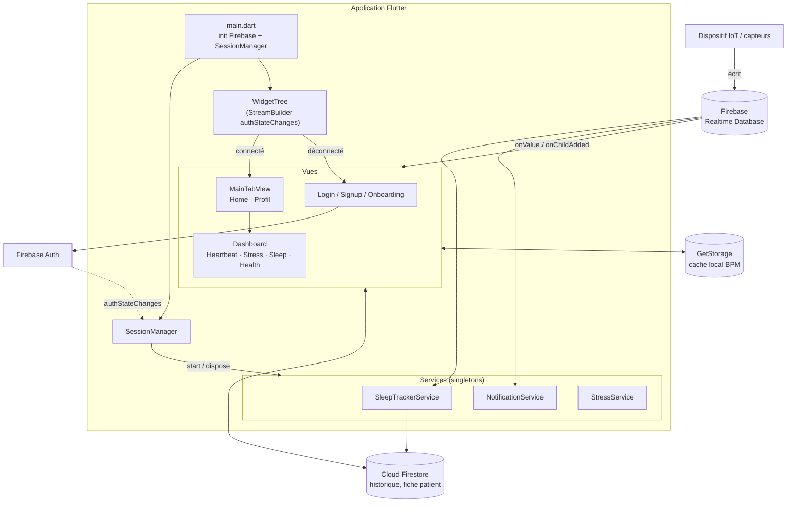

# LifeBeat

**LifeBeat** est une application mobile Flutter de **suivi de santé à distance**. Elle se connecte à un dispositif de mesure (capteurs IoT) qui envoie ses données vers Firebase, et affiche en temps réel les constantes vitales d'un patient : rythme cardiaque, température, niveau de stress, sommeil et pas. Elle envoie aussi des alertes à l'aide de notifications.

---

## Fonctionnalités

- **Authentification** par e-mail / mot de passe (inscription, connexion, déconnexion)
- **Onboarding** et écran de bienvenue
- **Accueil** : résumé du patient (BPM, température, statut) mis à jour en direct
- **Rythme cardiaque** : courbe temps réel (30 derniers points, conservés en local) et moyenne
- **Niveau de stress** : courbe sur la journée (relevés à 0h, 4h, 8h, 12h, 16h, 20h)
- **Suivi du sommeil** : détection automatique début/fin de sommeil et cumul hebdomadaire
- **Pas** et **vue d'ensemble de la santé** (health overview)
- ‍**Fiche patient** : nom, âge, sexe, groupe sanguin, poids, taille, adresse, téléphone (modifiable)
- **Alertes** : notifications locales en temps réel + historique des alertes (avec suppression)
- **Profil utilisateur** et édition du profil

---

## Stack technique

| Domaine | Technologie |
|---|---|
| Framework | Flutter (Dart) |
| Authentification | `firebase_auth` |
| Données temps réel | Firebase Realtime Database (`firebase_database`) |
| Historique / profils | Cloud Firestore (`cloud_firestore`) |
| Graphiques | `fl_chart` |
| Stockage local | `get_storage` |
| Notifications | `flutter_local_notifications` |
| Formatage dates | `intl` |
| Police / thème | Poppins, palette centralisée (`TColor`) |

---

## Architecture

LifeBeat suit une organisation **en couches simple** : *Vues (UI) → Services (logique) → Firebase*. Les services sont des **singletons** qui tournent en arrière-plan et sont pilotés par l'état d'authentification.



### Flux de démarrage

1. `main.dart` initialise Firebase, démarre le `SessionManager` et le `SleepTrackerService`, puis lance `MyApp`.
2. `WidgetTree` écoute `FirebaseAuth.authStateChanges()` :
   - utilisateur **connecté** → `MainTabView` (Accueil / Profil)
   - utilisateur **déconnecté** → `StartedView` (onboarding / login)
3. `SessionManager` écoute aussi l'état d'authentification : à la **connexion** il démarre `SleepTrackerService` et `NotificationService`, à la **déconnexion** il les arrête.

### Deux sources de données complémentaires

- **Realtime Database** : données *live* envoyées par le dispositif (BPM, température, stress, pas, sommeil, alertes, nom du patient).
- **Firestore** : données *persistées* et historiques (somme de sommeil par jour de la semaine, session de sommeil en cours, courbe de stress, fiche patient).

### Services

| Service | Rôle |
|---|---|
| `SessionManager` | Démarre/arrête les services selon la session Firebase Auth |
| `SleepTrackerService` | Écoute `en_sommeil`, calcule la durée de sommeil, cumule par jour (1 à 7) dans Firestore, remet à zéro chaque jour, et reprend une session interrompue après redémarrage |
| `NotificationService` | Écoute les nouvelles alertes (`onChildAdded`) et affiche une notification locale Android |
| `StressService` / `StressFirestoreService` | Lecture/écriture du niveau de stress (Realtime DB / Firestore) |

### Modèle de données (Firebase)

**Realtime Database** (nœud racine du patient)

```
<racine>/
├── beatsPerMinute     # rythme cardiaque
├── temperature
├── stress
├── steps
├── en_sommeil         # true/1 = endormi
├── Status
├── Nom&Preanom
└── alertes/
    └── <id>/ { message, type }
```

**Cloud Firestore**

```
<collection>/
├── patient        # name, age, gender, blood_type, weight, height, address, phone
├── weekly         # weeklySleepData {1..7}, lastResetDate
├── currentSession # startTime, endTime, durationInMinutes, status
└── data           # stress par heure {0,4,8,12,16,20}
```

> ℹDans le code actuel, les noms de nœuds/collections (`BoblEponge`, `Spongbob`) sont des noms de test codés en dur. Pense à les remplacer par un identifiant patient dynamique pour une vraie utilisation multi-patients.

---

## Structure du projet

```
lib/
├── main.dart                  # Point d'entrée
├── common/                    # Thème (TColor), popups, état d'auth
│   ├── Color_extension.dart
│   ├── auth_state.dart
│   ├── form_popup.dart
│   └── signout_popup.dart
├── common_widget/             # Widgets réutilisables (boutons, champs, vagues, lignes...)
├── services/                  # Logique métier / accès Firebase (singletons)
│   ├── session_manager.dart
│   ├── sleep_tracker_service.dart
│   ├── notification_service.dart
│   ├── stress_service.dart
│   └── stress_firestore_service.dart
└── view/                      # Écrans
    ├── widget_tree.dart       # Routage selon l'authentification
    ├── on_boarding/           # Onboarding + écran de démarrage
    ├── login/                 # Welcome, login, signup, complete profile
    ├── main_tab/              # Navigation principale (onglets)
    ├── home/                  # Accueil, notifications
    ├── dashboard/             # Heartbeat, stress, sommeil, health overview, fiche patient
    └── profile/               # Profil et édition
```

---

## Installation

### Prérequis

- [Flutter SDK](https://docs.flutter.dev/get-started/install) (version stable récente)
- Un projet [Firebase](https://console.firebase.google.com/) avec **Authentication (e-mail/mot de passe)**, **Realtime Database** et **Cloud Firestore** activés
- Android Studio / VS Code avec un émulateur ou un téléphone

### Étapes

```bash
# 1. Cloner le dépôt
git clone https://github.com/<ton-utilisateur>/lifebeat.git
cd lifebeat

# 2. Installer les dépendances
flutter pub get

# 3. Configurer Firebase
dart pub global activate flutterfire_cli
flutterfire configure

# 4. Lancer l'application
flutter run
```

Place le fichier `google-services.json` dans `android/app/` si tu ne passes pas par `flutterfire configure`.

### Règles de sécurité

Pense à restreindre les règles Firebase (Realtime Database et Firestore) aux utilisateurs authentifiés avant toute mise en production.

---

## Pistes d'amélioration

- Gestion d'état centralisée (Provider / Riverpod / Bloc) à la place des `setState` et listeners dans les vues
- Identifiants patient dynamiques au lieu des chemins codés en dur
- Séparer la couche *repository* de la couche *service*
- Notifications iOS et en arrière-plan (FCM)
- Tests unitaires et de widgets

---

## Auteurs

- **Helmi Soudana**
- **Ines Gardabbou**
- **El Aziza Mariem Lanouar**

## Licence

À définir (par ex. MIT).