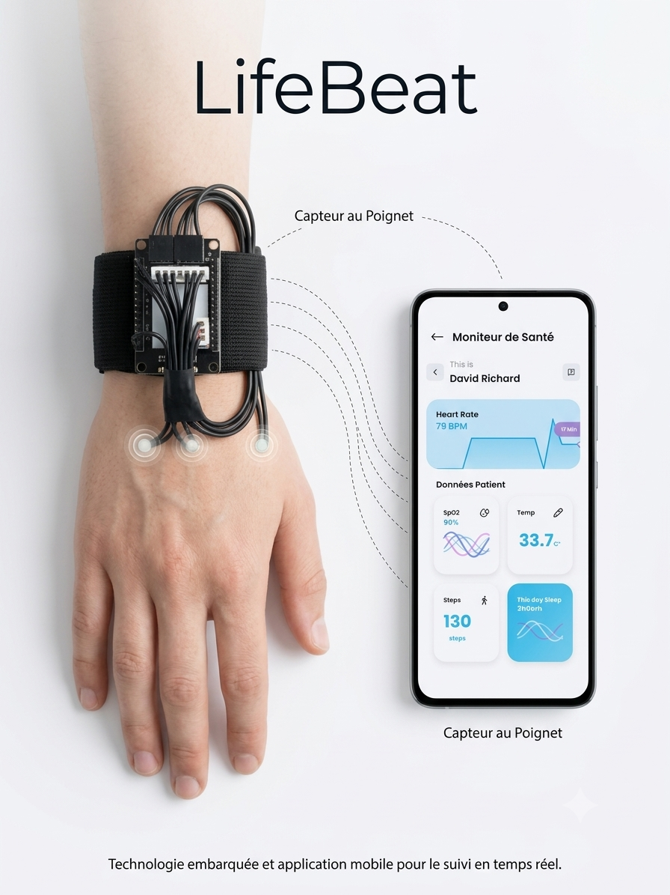
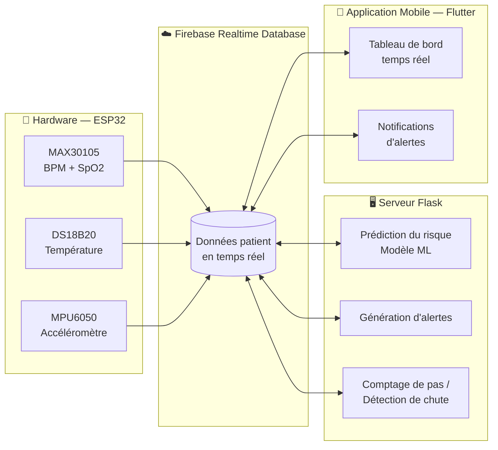

<div align="center">

#  LifeBeat

### Surveillance médicale intelligente des patients
<div align="center">



</div>
*Un dispositif connecté, une application mobile et un serveur intelligent
pour surveiller les patients en temps réel et prévenir les risques avant
qu'ils ne deviennent critiques.*


</div>

---

##  Sommaire

- [Aperçu](#-aperçu)
- [Démo](#-démo)
- [Fonctionnalités](#-fonctionnalités)
- [Architecture](#-architecture)
- [Stack technique](#-stack-technique)
- [Structure du dépôt](#-structure-du-dépôt)
- [Démarrage rapide](#-démarrage-rapide)
- [Équipe & contexte](#-équipe--contexte)
- [Licence](#-licence)

---

##  Aperçu

**LifeBeat** est un système de e-santé (IoT + Intelligence Artificielle)
conçu pour surveiller à distance les signes vitaux d'un patient et alerter
automatiquement en cas d'anomalie.

Un dispositif portable mesure en continu la fréquence cardiaque, la
saturation en oxygène (SpO2), la température corporelle et les mouvements
du patient. Ces données sont transmises en temps réel à un serveur qui,
grâce à un modèle de machine learning, évalue le niveau de risque du
patient et déclenche des alertes visibles instantanément depuis
l'application mobile.

---

##  Démo


---

##  Fonctionnalités

| | |
|---|---|
|  **Suivi en temps réel** | Fréquence cardiaque, SpO2, température, mouvements |
|  **Prédiction du risque** | Modèle de machine learning (arbre de décision) |
|  **Alertes automatiques** | Température élevée, rythme cardiaque anormal, SpO2 basse, risque élevé |
|  **Comptage de pas** | Calculé à partir des données de l'accéléromètre |
|  **Détection de chute** | Basée sur la magnitude de l'accélération |
|  **Synchronisation cloud** | Firebase Realtime Database, mise à jour en direct sur mobile |

---

##  Architecture



###  Hardware — capteurs & microcontrôleur

| Composant | Modèle | Rôle |
|---|---|---|
| Microcontrôleur | **ESP32** | Acquisition des capteurs + envoi Wi-Fi vers Firebase |
| Capteur cardiaque / SpO2 | **MAX30105** | Mesure du BPM et de la saturation en oxygène |
| Capteur de température | **DS18B20** | Température corporelle (bus OneWire) |
| Centrale inertielle | **MPU6050** | Accélération 3 axes (pas, chutes) |

Le firmware lit les capteurs en continu, calcule le BPM et le SpO2,
horodate chaque mesure, puis envoie les données à Firebase Realtime
Database via Wi-Fi.

###  Serveur backend

Serveur **Flask** organisé en architecture professionnelle (models /
services / monitoring / api) qui :
1. lit en continu les données du patient sur Firebase,
2. exécute le modèle de machine learning pour prédire le niveau de risque,
3. génère les alertes médicales selon des seuils configurables,
4. calcule le nombre de pas et détecte les chutes.

📁 Détails complets, installation et configuration :
[`server/README.md`](server/README.md)

###  Application mobile

Application **Flutter** connectée à Firebase, qui affiche en temps réel
l'état du patient et les alertes générées par le serveur.


📁 Code source : [`mobile/`](mobile/)

---

##  Stack technique

<div align="center">

| Couche | Technologies |
|---|---|
| **Hardware** | ESP32, MAX30105, DS18B20, MPU6050, C++ (Arduino) |
| **Mobile** | Flutter, Dart, Firebase SDK |
| **Backend** | Python, Flask, Firebase Admin SDK, scikit-learn, pandas |
| **Base de données** | Firebase Realtime Database |
| **Machine Learning** | Arbre de décision (scikit-learn) |

</div>

---

## 📁 Structure du dépôt

```
LifeBeat/
├── README.md              # Ce fichier
├── demo/                  # Images et vidéo de démonstration
│   ├── screenshot.png
│   └── demo-video.mp4
├── server/                 # Serveur backend Flask
├── mobile/                  # Application mobile Flutter
└── hardware/                 # Firmware ESP32 (capteurs)
```

---

##  Démarrage rapide

| Composant | Instructions |
|---|---|
|  Serveur | Voir [`server/README.md`](server/README.md) |
|  Mobile | `flutter pub get` puis `flutter run` (voir `mobile/README.md`) |
|  Hardware | Flasher le firmware ESP32 via l'IDE Arduino (voir `hardware/README.md`) |

---

## 👥 Équipe & contexte

Ce projet a été réalisé dans le cadre d'un **projet académique**.

> Helmi Soudana

> ElAziza Mariam Lanouar

> Ines Gardabbou


---

## 📄 Licence

Projet académique / privé — non destiné à une distribution publique sous
licence open source.