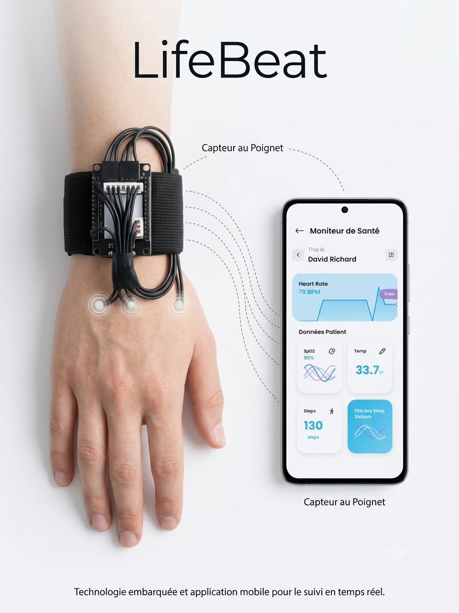
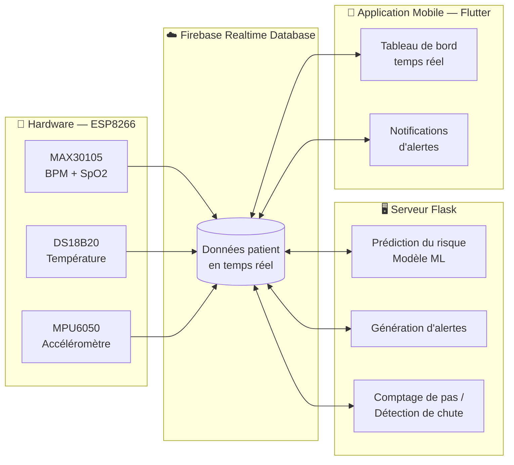

<div align="center">

# LifeBeat

### Connected health monitoring bracelet · Surveillance médicale intelligente des patients




</div>

---

## In short (English)

**LifeBeat** is an IoT + AI e-health system that monitors a patient's vital signs remotely and raises alerts automatically.

- A wearable device measures **heart rate, SpO2, body temperature and movement** and sends the data in real time to **Firebase Realtime Database**.
- A **Flask server** runs a **machine-learning model (decision tree, scikit-learn)** to estimate the patient's risk level, generates alerts, counts steps and detects falls.
- A **Flutter mobile app** shows the patient's status and alerts live.

**Demo videos:** [▶ Demo 1](demo/demo1.mp4) · [▶ Demo 2](demo/demo2.mp4) · **Full report (FR):** [Rapport-LifeBeat.pdf](Rapport-LifeBeat.pdf)

---

## Sommaire

- [Aperçu](#aperçu)
- [Démo](#démo)
- [Fonctionnalités](#fonctionnalités)
- [Architecture](#architecture)
- [Stack technique](#stack-technique)
- [Structure du dépôt](#structure-du-dépôt)
- [Démarrage rapide](#démarrage-rapide)
- [Équipe & contexte](#équipe--contexte)
- [Licence](#licence)

---

## Aperçu

**LifeBeat** est un système de e-santé (IoT + Intelligence Artificielle) conçu pour surveiller à distance les signes vitaux d'un patient et alerter automatiquement en cas d'anomalie.

Un dispositif portable mesure en continu la fréquence cardiaque, la saturation en oxygène (SpO2), la température corporelle et les mouvements du patient. Ces données sont transmises en temps réel à un serveur qui, grâce à un modèle de machine learning, évalue le niveau de risque du patient et déclenche des alertes visibles instantanément depuis l'application mobile.

---

## Démo

▶ [Vidéo de démonstration 1](demo/demo1.mp4) · ▶ [Vidéo de démonstration 2](demo/demo2.mp4)

---

## Fonctionnalités

| | |
|---|---|
| **Suivi en temps réel** | Fréquence cardiaque, SpO2, température, mouvements |
| **Prédiction du risque** | Modèle de machine learning (arbre de décision) |
| **Alertes automatiques** | Température élevée, rythme cardiaque anormal, SpO2 basse, risque élevé |
| **Comptage de pas** | Calculé à partir des données de l'accéléromètre |
| **Détection de chute** | Basée sur la magnitude de l'accélération |
| **Synchronisation cloud** | Firebase Realtime Database, mise à jour en direct sur mobile |

---

## Architecture



### Hardware — capteurs & microcontrôleur

| Composant | Modèle | Rôle |
|---|---|---|
| Microcontrôleur | **ESP8266 (NodeMCU)** | Acquisition des capteurs + envoi Wi-Fi vers Firebase |
| Capteur cardiaque / SpO2 | **MAX30105** | Mesure du BPM et de la saturation en oxygène |
| Capteur de température | **DS18B20** | Température corporelle (bus OneWire) |
| Centrale inertielle | **MPU6050** | Accélération 3 axes (pas, chutes) |

Le firmware lit les capteurs en continu, calcule le BPM et le SpO2, horodate chaque mesure, puis envoie les données à Firebase Realtime Database via Wi-Fi.

📁 Code : [`Hardware/projetheartbeat/`](Hardware/projetheartbeat/)

### Serveur backend

Serveur **Flask** organisé en architecture professionnelle (models / services / monitoring / api) qui :
1. lit en continu les données du patient sur Firebase,
2. exécute le modèle de machine learning pour prédire le niveau de risque,
3. génère les alertes médicales selon des seuils configurables,
4. calcule le nombre de pas et détecte les chutes.

📁 Détails complets, installation et configuration : [`LifeBeatServer/README.md`](LifeBeatServer/README.md)

### Application mobile

Application **Flutter** connectée à Firebase, qui affiche en temps réel l'état du patient et les alertes générées par le serveur.

📁 Code source : [`AppMobile/`](AppMobile/)

---

## Stack technique

<div align="center">

| Couche | Technologies |
|---|---|
| **Hardware** | ESP8266, MAX30105, DS18B20, MPU6050, C++ (Arduino) |
| **Mobile** | Flutter, Dart, Firebase SDK |
| **Backend** | Python, Flask, Firebase Admin SDK, scikit-learn, pandas |
| **Base de données** | Firebase Realtime Database |
| **Machine Learning** | Arbre de décision (scikit-learn) |

</div>

---

## Structure du dépôt

```
LifeBeat/
├── README.md               # Ce fichier
├── Rapport-LifeBeat.pdf    # Rapport du projet
├── demo/                   # Bannière et vidéos de démonstration
├── Hardware/               # Firmware (capteurs, Wi-Fi, Firebase)
├── LifeBeatServer/         # Serveur backend Flask + modèle ML
└── AppMobile/              # Application mobile Flutter
```

---

## Démarrage rapide

| Composant | Instructions |
|---|---|
| Serveur | Voir [`LifeBeatServer/README.md`](LifeBeatServer/README.md) |
| Mobile | `cd AppMobile`, puis `flutter pub get` et `flutter run` |
| Hardware | Dans `Hardware/projetheartbeat/projetheartbeat.ino`, remplacer les valeurs `YOUR_...` par vos identifiants Wi-Fi et Firebase, puis flasher la carte via l'IDE Arduino |

---

## Équipe & contexte

Ce projet a été réalisé dans le cadre d'un **projet académique** par :

- Helmi Soudana
- El Aziza Mariem Lanouar
- Ines Gardabbou

---

## Licence

Projet académique — non destiné à une distribution publique sous licence open source.
